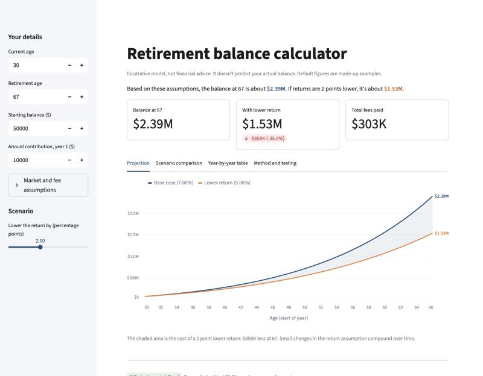

# Retirement Balance Calculator: Excel to Python

> **Illustrative model, not financial advice.** It shows how assumptions combine. It does not predict anyone's actual retirement balance. All numbers are made-up examples; no real customer or company data is used.

This project takes an Excel retirement projection model, rebuilds it as tested Python, reconciles the two, and puts it behind a simple web calculator for non-technical users.



## What's here

| File | Purpose |
|---|---|
| `retirement_model.xlsx` | The Excel model. An **Inputs** sheet (yellow cells are editable, one column per test case) and one year-by-year projection sheet per case. Every projection cell is a live formula. |
| `model.py` | The Python version. `project(Inputs)` returns the same year-by-year table as a pandas DataFrame. Also holds the 5 test cases. |
| `test_reconciliation.py` | Runs the 5 test cases and compares Python against Excel, cell by cell. |
| `app.py` | Streamlit calculator: plain-English summary, balance-over-time chart, lower-return scenario comparison, year-by-year table, and a live Python-vs-Excel reconciliation check. |
| `.streamlit/config.toml` | App theme (neutral navy accent, light background). |
| `build_excel.py` | Generates `retirement_model.xlsx` from the same test cases, so the workbook is reproducible. |
| `export_excel_values.py` | (macOS + Excel) Has Excel calculate the workbook and saves Excel's own values to `excel_outputs.csv`. |
| `excel_outputs.csv` | The values Excel calculated, used by the reconciliation test. |

## Assumptions

| Input | Meaning |
|---|---|
| Current age, retirement age | Projection runs for `retirement age − current age` years. The age shown is the age at the start of each year. |
| Starting balance | Balance at the start of year 1. |
| Annual contribution | Contribution in year 1, paid at the **start** of the year. |
| Contribution growth | Contributions rise by this rate each year (e.g. wage growth). |
| Expected annual return | A constant return applied every year. |
| Annual fee | A percentage of the balance, charged at the **end** of each year after returns. |

Not modelled: tax, inflation, insurance premiums, fixed-dollar fees, contribution caps, and year-to-year variation in returns.

## Calculation logic

The same method is used in Excel and Python. For each year *t*:

```
contribution      = annual_contribution × (1 + contribution_growth)^(t − 1)
investment_return = (opening_balance + contribution) × expected_return
fees              = (opening_balance + contribution + investment_return) × fee_rate
closing_balance   = opening_balance + contribution + investment_return − fees
```

Equivalently: closing balance = (opening + contribution) × (1 + return), then fees are deducted as a percentage of that balance. Next year's opening balance is this year's closing balance.

**Hand check (base case, year 1):** opening $50,000 + contribution $10,000 = $60,000. Return 7% = $4,200. Balance before fees $64,200. Fees 1% = $642. Closing balance **$63,558**. Excel and Python both produce $63,558.00.

## Testing results

Five cases, every year and every money column compared (opening balance, contribution, return, fees, closing balance). Output of `python test_reconciliation.py`:

| Case | Inputs that differ from base | Years | Python final balance | Excel final balance | Max difference |
|---|---|---|---|---|---|
| Base case | age 30→67, $50k start, $10k/yr, 7% return, 1% fee, 3% contribution growth | 37 | $2,388,977.50 | $2,388,977.50 | $0.00005 |
| Zero return | return 0% | 37 | $602,677.41 | $602,677.41 | $0.00005 |
| Zero fees | fee 0% | 37 | $3,082,450.62 | $3,082,450.62 | $0.00005 |
| High return | return 12% | 37 | $8,288,459.85 | $8,288,459.85 | $0.00005 |
| Late start | age 55→67, $0 start, $15k/yr | 12 | $309,410.14 | $309,410.14 | $0.00005 |

**Maximum difference across all cases: $0.00005, well under the $0.01 target.** All 5 pytest tests pass. The tiny remaining difference comes from Excel's automation interface returning values rounded to 4 decimal places, not from the calculation logic.

Sensitivity (from the app, base case): a return 2 percentage points lower (5% instead of 7%) cuts the balance at 67 from $2,388,977 to $1,531,003, a fall of $857,975 (35.9%).

## How to run

```bash
python3 -m venv .venv
source .venv/bin/activate
pip install -r requirements.txt

python test_reconciliation.py   # reconciliation report
pytest test_reconciliation.py   # same checks as tests
streamlit run app.py            # opens the calculator at http://localhost:8501
```

To regenerate the Excel model and Excel's values (macOS with Microsoft Excel):

```bash
python build_excel.py
python export_excel_values.py
```

If you open `retirement_model.xlsx` in Excel and save it, the test reads the calculated values straight from the workbook instead of the CSV.

## Known limitations

- Returns are constant every year. Real returns vary, and the order of good and bad years matters (sequence risk). A fixed return understates that uncertainty.
- No tax, inflation, insurance, or contribution caps, so balances are nominal, pre-tax and overstated against real-world outcomes.
- Fees are a flat percentage; real products often add fixed dollar fees.
- Annual time steps; contributions are assumed to be paid in a lump at the start of each year.
- Reconciliation needs Microsoft Excel on macOS to refresh `excel_outputs.csv`. The committed CSV lets anyone run the tests without Excel.
